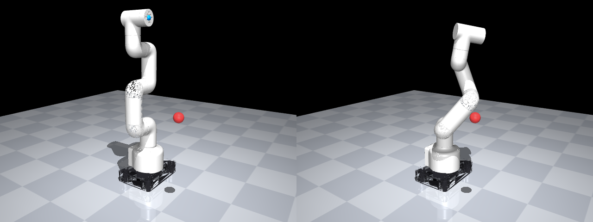

# myCobot 280 in MuJoCo: minimum-servo reaching

A MuJoCo model of the Elephant Robotics myCobot 280, built from the official URDF and
meshes, plus tools to move the tool tip to any 3D point while moving as few servos as
possible. It includes an exact optimiser and reinforcement-learning (PPO / SAC) versions.



## What's inside

| Path | What it is |
|---|---|
| `models/mycobot_280_m5.xml` | myCobot 280 **M5** model (default) |
| `models/mycobot_280_pi.xml` | myCobot 280 **Pi** model (base is 8 mm taller, different J1 shell) |
| `models/meshes_*/` | Official meshes converted to STL |
| `view_model.py` | Open the arm in the viewer and drive the servos with sliders |
| `reach.py` | Give it x y z and it finds the fewest servos that reach that point, then animates it |
| `min_servo_ik.py` | The exact minimum-servo solver (importable) |
| `rl/min_servo_env.py` | Gymnasium environment with a servo-usage penalty |
| `rl/train.py` | Train PPO or SAC, then compare against the exact solver |
| `rl/pendulum_ppo_vs_sac.py` | PPO vs SAC on Pendulum-v1 (return, smoothness, plot) |
| `tools/build_model.py` | Rebuilds the models from the official repo (e.g. for the JN variant) |

## Install

```bash
pip install -r requirements.txt          # mujoco, numpy, scipy
pip install -r requirements-rl.txt       # only for the rl/ scripts
```

On macOS, run anything that opens the 3D viewer with `mjpython` instead of `python`
(it is installed with the `mujoco` package).

## Quick start

```bash
python view_model.py                       # look at the arm, move servos with the Control sliders
python reach.py 0.15 -0.10 0.20            # reach a point from the home pose
python reach.py 0.15 -0.10 0.20 --start 0 -30 60 0 0 0    # from another pose (degrees)
python reach.py 0.15 -0.10 0.20 --no-view  # print only
```

Coordinates are metres in the robot base frame: origin at the centre of the base on top of the
mounting plate, z up. The tip is the centre of the output flange face (the blue dot). Example output:

```
Minimum servos to move: 3  ->  servo(s) [1, 2, 3]
Servo   start(deg)   end(deg)   change(deg)
  J1        0.00     -33.69       -33.69  <- moves
  ...
For the real arm (pymycobot):  mc.send_angles([...], 30)
```

Joint angles in the model use the same zero and sign as the real arm (Elephant Robotics' own
ROS driver sends `degrees(joint_position)` straight to `send_angles`), so you can try the
printed angles on the hardware. Start slowly and keep a hand near the power switch.

## How "minimum servos" is solved

```
minimise   ||q - q0||_0          (how many servos change)
subject to tip(q) = p            (MuJoCo forward kinematics)
           q_min <= q <= q_max   (joint limits), and no link goes through the table
```

The L0 "norm" is combinatorial, but 6 joints only give 63 subsets, so `min_servo_ik.py`
checks them exactly in order of size (1, then 2, then 3, ...). For each subset the other
servos are locked and a bounded least-squares problem is solved from several starting
points, using MuJoCo's analytic Jacobian. The first size that reaches the target within
1 mm is the minimum. Ties are broken by the smallest total rotation (`--tiebreak max`
prefers the smallest single-servo move instead).

What to expect:

- A general 3D point has 3 equations, so it usually needs **3 servos**.
- 1 or 2 servos are enough only when the point lies on a circle or surface that those
  servos already sweep from the current pose.
- **J6 never helps** with position, because it spins the flange about the tip's own axis.
  It matters only for orientation or for a tool that sticks out off-axis.
- Each subset's feasibility is checked numerically (multi-start), so "not reachable with
  k servos" is a strong numerical result rather than a formal proof.

## Reinforcement learning

```bash
python rl/train.py --algo sac --steps 200000
python rl/train.py --algo ppo --steps 1000000 --envs 8
```

Reward = −distance − 0.5 × (each servo the first time it moves, the L0 cost)
− 0.01 × Σ|action| (L1 push towards sparsity) + 10 on success. The observation tells the
policy which servos it has already used. After training, the script reports the success rate
and the policy's average servo count next to the exact solver's minimum on the same targets.
If the policy uses too many servos, raise `--servo-penalty`; if it stops reaching, lower it.

Training time: SAC does a gradient update every step, so on a CPU expect a few hours for
200k steps (much less with a GPU). PPO with `--envs 8` gets through steps faster in
wall-clock time but usually needs more of them. SAC's entropy bonus encourages wiggling
every joint, so the script lowers its target entropy.

Watch a trained policy in the viewer (on macOS use `mjpython`):

```bash
mjpython rl/play_policy.py runs/ppo_min_servo.zip                          # random targets
mjpython rl/play_policy.py runs/ppo_min_servo.zip --target 0.15 -0.10 0.20
python   rl/play_policy.py runs/ppo_min_servo.zip --no-view                # print results only
```

`rl/pendulum_ppo_vs_sac.py` runs the Pendulum comparison: SAC typically solves the swing-up
in ~10–20k steps, while PPO usually needs far more.

## Which model should I use?

Use `mycobot_280_m5.xml` for the M5 (ESP32) version and `mycobot_280_pi.xml` for the Raspberry Pi
version. They differ in base height (131.56 mm vs 139.56 mm to J2), so using the wrong one
shifts every target by about 8 mm. For the Jetson Nano version:

```bash
git clone --depth 1 https://github.com/elephantrobotics/mycobot_ros
pip install trimesh pycollada
python tools/build_model.py --repo mycobot_ros --variant jn
```

## Credits

Kinematics and meshes come from Elephant Robotics'
[mycobot_ros](https://github.com/elephantrobotics/mycobot_ros) (BSD 3-Clause, see
`models/LICENSE_mycobot_ros`). Masses are estimated from mesh volume (about 0.77 kg for the moving arm), so the dynamics are
approximate. Kinematics match the official URDF to within a micron (checked over 200 random poses).
